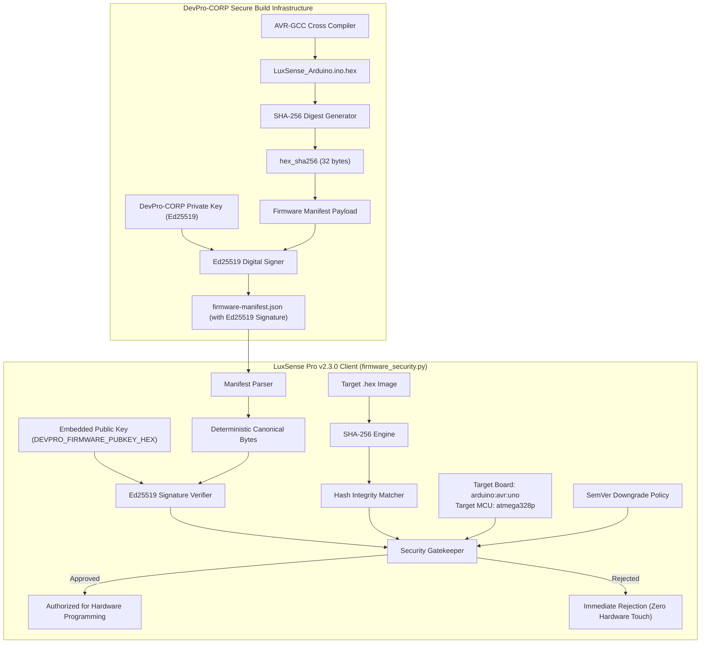
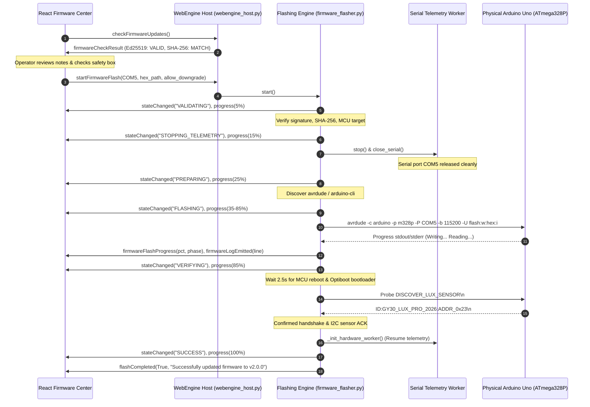

# LuxSense Pro v2.3.0 — Unified Software & Firmware Update Architecture

**Product:** LuxSense Pro — Optical Radiometry Workstation  
**Document Version:** 2.3.0-SPEC  
**Software Release:** v2.3.0  
**Microcode Release:** v2.0.0 (Independent Firmware Lifecycle)  
**Organization:** DevPro-CORP  
**Target Architecture:** Microsoft Windows 10/11 (64-bit) & Microchip ATmega328P (16MHz AVR)  
**Date:** November 15, 2026  

---

## 1. Architectural Philosophy & Permanent Release Policy

LuxSense Pro combines a high-performance Windows desktop application (React 18 + PySide6 Qt WebEngine) with embedded edge metrology firmware executing on an Arduino Uno R3 (Microchip ATmega328P @ 16 MHz).

### 1.1 The Non-Negotiable Invariants
1. **Never Flash Automatically:** Firmware updates directly overwrite microcontroller flash memory. The system enforces an absolute safeguard: **no firmware is ever flashed automatically**. Software updates cannot silently trigger firmware programming.
2. **Cryptographic Authorization:** Every firmware release binary (`.hex`) must be accompanied by an official manifest signed using the DevPro-CORP Root Authority Ed25519 private key. Unsigned, tampered, corrupted, or incompatible binaries are immediately rejected before hardware handoff.
3. **Decoupled Versioning:** Application software versions (e.g., `v2.3.0`) and embedded microcontroller firmware versions (e.g., `v2.0.0`) maintain independent lifecycles. Compatibility requirements are declared in release manifests (`min_firmware_version`, `target_board`, `target_mcu`).
4. **Decoupled User Storage:** User configuration (`settings.json`), calibration profiles (`calibration.json`), and SQLite historical telemetry (`history.db`) reside in standard OS AppData (`%APPDATA%\DevPro\LuxSensePro\`). Neither software updates nor firmware flashing can overwrite user metrology data.
5. **Universal Distribution Bundle:** Every release delivers complete, independent distribution artifacts:
   - Standalone Windows Inno Setup installer (`LuxSense-Pro-Setup-v2.3.0.exe`).
   - Self-contained portable ZIP distribution (`LuxSense-Pro-v2.3.0-portable.zip`).
   - Standalone application updater bootstrapper (`updater.exe`).
   - Official release checksums (`SHA256SUMS.txt`).
   - Software release manifest (`release-manifest.json`).
   - Cryptographically signed firmware manifest (`firmware-manifest.json`) and compiled Intel HEX image (`LuxSense_Arduino.ino.hex`).

---

## 2. Cryptographic Security Engine



### 2.1 Cryptographic Primitives
* **Digital Signatures:** Ed25519 (EdDSA over Curve25519 per RFC 8032) providing 128-bit post-quantum resistance, immunity to timing attacks, and deterministic 64-byte signatures.
* **Integrity Hashing:** SHA-256 cryptographic digest matching binary byte-for-byte against manifest declarations.
* **Embedded Trusted Root:**
  ```python
  DEVPRO_FIRMWARE_PUBKEY_HEX = "9a1dc8f01459c05ebb77abbfc71f3b36b00f5aafdf1bc186914085d24bb52d0d"
  ```
  The corresponding private key resides strictly in offline protected storage (`private_keys/`) and is never packaged in application builds or distributed binaries.

### 2.2 Security Rules Enforced
1. **Signature Validity:** If manifest signature verification fails, execution halts immediately with `Security rejection: Digital signature does not match manifest payload`.
2. **Hash Integrity:** If computed SHA-256 differs from `manifest.hex_sha256`, the file is identified as corrupted or modified and rejected.
3. **Hardware & MCU Compatibility:** The target board must match `arduino:avr:uno` and the MCU must match `atmega328p`. Incompatible boards (e.g. ESP32, STM32, ATmega2560) cannot be flashed.
4. **SemVer Downgrade Protection:** Firmware with version numbers lower than the currently detected installed version is rejected unless the operator explicitly checks the `Authorize downgrade` override in the UI.

---

## 3. Five-Phase Controlled Flashing Lifecycle

Flashing is executed by `software/core/firmware_flasher.py` via a dedicated background worker (`FirmwareFlashWorker`), ensuring the desktop UI remains responsive and real-time diagnostic logs are continuously streamed.



### Phase Details:
1. **Phase 1: Validating (0%–15%)**
   - Full security verification of signed manifest and Intel HEX image.
   - Evaluates downgrade and hardware compatibility.
2. **Phase 2: Stopping Telemetry (15%–25%)**
   - Signals active Python `SerialWorker` thread to cleanly terminate sampling loop and release OS port handle (`COM5`).
   - Verifies exclusive write access to the serial device.
3. **Phase 3: Preparing (25%–35%)**
   - Auto-discovers programming toolchain (`avrdude` with `avrdude.conf` or `arduino-cli`).
   - Configures STK500v1 protocol parameters (`-c arduino -p m328p -b 115200`).
4. **Phase 4: Flashing (35%–85%)**
   - Launches programmer subprocess with pipe redirection.
   - Parses real-time byte write and read-back verification percentages.
   - Enforces 45-second execution timeout guard against frozen microcontrollers.
   - Captures all diagnostic output to `%APPDATA%\DevPro\LuxSensePro\firmware_flash.log`.
5. **Phase 5: Hardware-in-the-Loop Post-Flash Verification (85%–100%)**
   - Waits 2.5s for ATmega328P auto-reset and Optiboot bootloader transition to sketch execution.
   - Re-opens serial bus and transmits discovery command (`DISCOVER_LUX_SENSOR\n`).
   - Verifies canonical handshake response: `ID:GY30_LUX_PRO_2026:ADDR_0x23` or `ADDR_0x5C`.
   - Re-attaches background telemetry worker, verifying real sensor packets before declaring completion.

---

## 4. Hardware Failure & Recovery Handling

Because the standard Arduino Uno R3 uses an ATmega328P microcontroller with 32 KB single-bank flash memory, **dual-bank automatic firmware rollback is physically impossible**. The application explicitly communicates this reality rather than making false claims of automatic recovery.

* If flashing fails:
  1. Diagnostic logs are preserved to `%APPDATA%\DevPro\LuxSensePro\firmware_flash.log`.
  2. The application provides immediate access to the interactive **Hardware Recovery & Bootloader Guide**.
  3. User settings, calibration profiles, and measurement history remain completely uncorrupted.
  4. The Optiboot bootloader remains intact in high memory (`0x7E00`), allowing immediate recovery by re-triggering the flash sequence after USB power-cycling.
